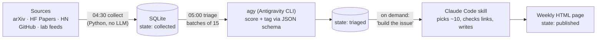

# newsletter-ia

🇧🇷 [Leia em português](README.pt-BR.md)


A personal weekly AI newsletter built straight from primary sources — research labs, arXiv, GitHub, Hacker News and Hugging Face — instead of social media and aggregators.

A cheap pipeline does the heavy lifting: plain Python collects and deduplicates items, a small LLM scores them in batches, and Claude only steps in once a week to pick ~10 items, check the links and write the issue. Everything runs locally.

> Built for my own always-on Linux box, so paths point to my machine. It is not a package for third parties, but the code and the design are open to read.

## How it works



| Stage | Done by | Cost |
| :--- | :--- | :--- |
| Collection and dedup | Python (no LLM) | zero |
| Bulk triage | `agy`, capped at 150 items/day | ~50–95k input tokens per batch |
| Curation and writing | Claude, through a skill | one session per week |

## Engineering highlights

- **Cost-aware LLM pipeline:** each stage uses the cheapest tool that can do the job; the expensive model only sees ~25 pre-ranked candidates.
- **Structured output with validation:** triage responses must match a JSON schema and are rejected otherwise.
- **Measuring the model, not trusting it:** `amostra` + `concordancia` compare the LLM's scores with human labels and only pass at ≥ 0.70 agreement.
- **Failure isolation:** one broken source does not stop the others; the run exits non-zero so systemd and the journal show it.
- **Explicit item lifecycle:** collected → triaged → drafted → published, with commands to revert.
- **66 unit tests** that run offline in under a second.

## Sources (v1)

| Source | How | Filter |
| :--- | :--- | :--- |
| arXiv `cs.LG`, `cs.CL`, `cs.MA`, `cs.AI` | Atom API, 300 per category, 3 s between calls | AI term in the title **or** paper listed on HF Daily Papers |
| Hugging Face Daily Papers | `api/daily_papers?sort=trending` | — |
| Hacker News | Algolia `search_by_date` | ≥ 50 points |
| GitHub | `search/repositories` (there is no trending API) | created in the window, pushed in the last 30 days, drops jumps of > 20k stars in < 7 days |
| Feeds | DeepMind, HF blog, Microsoft Research, OpenAI, Interconnects, Import AI, Latent Space | — |

## Running

Requires Linux with user-level systemd, Python 3.12, `agy` logged in and Claude Code for the curation step.

```bash
git clone https://github.com/Guilherme-L-C/newsletter-ia.git ~/newsletter-ia
cd ~/newsletter-ia
pip install -r requirements.txt
python3 -m unittest tests.test_newsletter_ia      # 66 tests, no network

# timers
ln -sf ~/newsletter-ia/systemd/newsletter-ia-* ~/.config/systemd/user/
systemctl --user daemon-reload
systemctl --user enable --now newsletter-ia-coletar.timer newsletter-ia-triar.timer

# Claude Code skill
ln -sfn ~/newsletter-ia/skill/montar-edicao ~/.claude/skills/montar-edicao
```

Main commands (`python3 -m newsletter_ia <command>`): `coletar` (collect), `triar` (triage), `candidatos` (candidates as JSON), `edicao` (write the weekly issue and rebuild the page), `publicado` / `rascunhado` / `reverter` (item states), `amostra` and `concordancia` (validate the triage). Full reference in the [Portuguese README](README.pt-BR.md#uso).

## Project structure

```
newsletter_ia/       package (CLI in __main__.py)
  fontes/            one file per source
  coletar.py         runs the sources, isolates failures
  triar.py           prompt, agy call, response validation
  selecao.py         candidates and item states
  validacao.py       sampling and agreement score
  pagina.py          HTML page with every issue
tests/               unittest, offline
systemd/             collection and triage units
skill/montar-edicao/ Claude Code skill
docs/                design decisions and implementation plan
```

## Known limitations

- The first validation (0.75) had little power: 18 of 20 sampled items were labeled "good".
- `agy` gives 9–10 to brand-new personal repos with polished READMEs; a minimum-stars filter at collection time is still missing.
- GitHub collection only sees repos created in the window, so an old repo that suddenly takes off is missed.

More details, and the plan for a magazine-style v2, in [`docs/design.md`](docs/design.md).

## License

[MIT](LICENSE) © Guilherme Leite Cavalcanti
